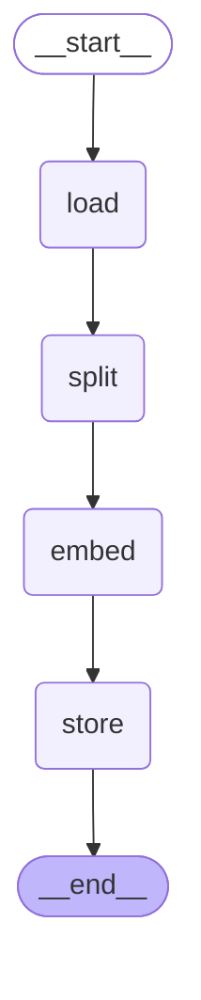

# PDF Vectorisation Pipeline (LangChain / LangGraph)

Assessment for Nestack Technologies.

**Live deployment:** https://krishnapriya-nestack-submission-1.onrender.com/docs

- No authentication is required.
- `GET /` returns a health check. Test the API with `POST /query` on the `/docs` page.
- Free hosting sleeps when idle, so the first request may take 30-60 seconds.

## Overview

1. **Ingestion (`ingest.py`)**: loads a PDF, splits it into chunks, embeds the chunks, and saves them to a FAISS index.
2. **Retrieval (`app.py`)**: a FastAPI server with a `POST /query` endpoint that runs `similarity_search_with_score()` directly on the vector store. There is no LLM and no QA chain. It returns raw chunks.

## Setup and run

```bash
python -m venv venv
venv\Scripts\activate          # Windows
# source venv/bin/activate     # Mac/Linux
pip install -r requirements.txt
python ingest.py --file data/sample.pdf
uvicorn app:app --reload
```

Then open http://127.0.0.1:8000/docs. To regenerate `results.json`, keep the server running and run `python run_queries.py` in a second terminal.

## API

`POST /query`

Request:
```json
{ "query": "How is the submission evaluated?", "top_k": 3 }
```

Response: an array of `{ chunk_text, page_number, score }`.

Example:
```bash
curl -X POST https://krishnapriya-nestack-submission-1.onrender.com/query \
  -H "Content-Type: application/json" \
  -d '{"query": "How is the submission evaluated?", "top_k": 3}'
```

**Score:** FAISS returns an L2 distance, so a **lower score means a better match**.

## Component choices

| Stage | Choice | Why |
|---|---|---|
| Loader | `PyPDFLoader` | Lightweight, and keeps the page number in each document's metadata, which the response needs. |
| Splitter | `RecursiveCharacterTextSplitter` | Splits at paragraphs, then sentences, then words, so chunks stay coherent. |
| Chunk size / overlap | 1000 / 200 | About 250 tokens per chunk, a good size for a small embedding model. The 20% overlap keeps sentences at chunk boundaries retrievable. |
| Embeddings | `FastEmbedEmbeddings` (`BAAI/bge-small-en-v1.5`) | Free, runs locally with no API key, and uses little memory (no PyTorch), so it fits on a free host. |
| Vector store | `FAISS` | Fast and local. `save_local()` is its built-in persistence method. |

Ingestion and retrieval share the same settings through `config.py`, so the query is embedded with the same model used for ingestion.

## Ingestion Graph (LangGraph)

Nodes: `load` -> `split` -> `embed` -> `store`



Printed node list:
```
Graph nodes: ['__start__', 'load', 'split', 'embed', 'store', '__end__']
```

## Sample output

Query: "How is the submission evaluated?"

"query": "How is the submission evaluated?",
    "results": [
      {
        "chunk_text": "following contributors for evaluation:\n- bishal@nestack.com\n- sannidhya@nestack.com\n- sanjay@nestack.com\nYour submission must include:\n- A ZIP file of your complete codebase\n- A live deployment link\n- Any necessary credentials if your project includes authentication\nAdditionally, ensure your repository includes a README.md with:\n- The deployment link clearly mentioned\n- Setup and run instructions if applicable\nNOTE: PUBLIC REPOSITORIES ARE DISQUALIFIED FROM THE HIRING PROCESS",
        "page_number": 2,
        "score": 1.6420300006866455
      },
      {
        "chunk_text": "Technical Assessment - Nestack \nDo not share or distribute this document. Page PAGE \nEVALUATION \nCriterion Weight What we look for \nPipeline runs end-to-end without errors 35% Ingestion completes; retrieval returns \nrelevant results. \nCorrect use of LangChain primitives for each stage 25% Right component used for the right \npurpose; no misuse of chains. \nRetrieval quality - relevance of returned chunks 20% results.json entries are semantically \nrelevant to each query. \nREADME quality and component choices with reasoning 15% Can justify each LangChain component \nselected. \nLangGraph graph structure and documentation (bonus) +5% Named nodes, documented flow, \ninspectable graph. \nInstructions\nKindly create a private GitHub repository named: {yourName_Nestack_Submission} (e.g., roy_Nestack_Submission) and add the \nfollowing contributors for evaluation:\n- bishal@nestack.com\n- sannidhya@nestack.com\n- sanjay@nestack.com\nYour submission must include:\n- A ZIP file of your complete codebase",
        "page_number": 2,
        "score": 1.753283977508545
      },
      {
        "chunk_text": "\u2022 LangGraph is optional but will be evaluated positively if the graph is well-structured and documented. \n\u2022 Do not use RetrievalQA, ConversationalRetrievalChain, or any pre-built RAG chain for the retrieval endpoint. \n\u2022 The pipeline must run successfully on the sample PDF provided on the assessment platform. \nDELIVERABLES \n\u2022 Ingestion script and retrieval server, fully runnable from your README instructions. \n\u2022 README: setup and install steps (include a requirements.txt), justification for your choice of loader, splitter, \nembedding model, and vector store, and sample output from the provided PDF. \n\u2022 results.json: output of at least three different queries run against the provided PDF, in the response format above. \n\u2022 If LangGraph is used: a printed node list or diagram showing the ingestion graph structure, included in the README.",
        "page_number": 1,
        "score": 1.7976305484771729
      }
The full output for five queries is in `results.json`.

## Project structure

```
ingest.py        ingestion pipeline (LangGraph)
app.py           retrieval API (FastAPI)
config.py        shared settings
run_queries.py   generates results.json
results.json     sample query output
requirements.txt dependencies
data/sample.pdf  input PDF
```
